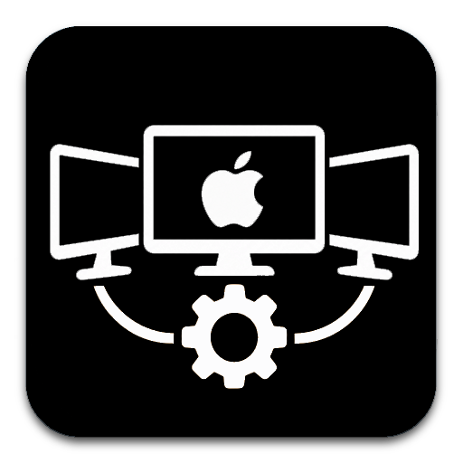

# Schermbeheer



**Turn your left or right external display black with one click from the macOS menu bar.**
*Zet met één klik in de menubalk je linker of rechter scherm op zwart.*

[🇬🇧 English](#english) · [🇳🇱 Nederlands](#nederlands)

---

## English

Schermbeheer is a small menu bar app for a Mac (for example an iMac) with an external display on the
left and one on the right. The menu bar shows three small rectangles (left – Mac – right):

| Icon | Meaning |
|------|---------|
| ▭ outlined | display is on |
| ▬ filled | display is black ("sleeping") |
| ┄ dashed | display not connected |

### Usage

- **Click the left rectangle** → left display goes black / back on.
- **Click the right rectangle** → right display goes black / back on.
- **Click the middle or right-click** → menu with:
  - Left / right display on/off
  - All displays on
  - **Launch at login** (checkbox)
  - Quit
- **Double-click a black display** to turn it back on.

The middle display (the Mac's built-in screen) always stays on. A display that is "off" gets a
fully black window on top of it; it stays connected and powered. The app remembers which displays
were off. When you quit, all displays turn back on.

The built-in display is detected automatically. The other displays are assigned left/right based on
their arrangement in *System Settings → Displays*.

### Install

1. Download `Schermbeheer-x.y.z.dmg` from the
   [latest release](https://github.com/rients-faber/3-screens-monitor-management/releases/latest).
2. Open the DMG and drag **Schermbeheer** to **Applications**.
3. The app is not notarized by Apple. The first time you open it:
   - Open the app; macOS refuses it.
   - Go to **System Settings → Privacy & Security** and click **Open Anyway** at the bottom.
   - Or in Terminal:
     ```bash
     xattr -dr com.apple.quarantine /Applications/Schermbeheer.app
     ```

Requires macOS 13 (Ventura) or later. Runs on Apple Silicon and Intel Macs.

### Build it yourself

You need Apple's Command Line Tools (`xcode-select --install`). Then:

```bash
git clone https://github.com/rients-faber/3-screens-monitor-management.git
cd 3-screens-monitor-management
./build.sh
```

The DMG ends up in `build/`. GitHub Actions also builds the DMG on every push; a tag like `v1.2.3`
publishes it as a release.

---

## Nederlands

Schermbeheer is een kleine menubalk-app voor een Mac (bijvoorbeeld een iMac) met links en rechts
een extra scherm. Boven in de menubalk staat een icoon met drie rechthoekjes (links – Mac – rechts):

| Icoon | Betekenis |
|-------|-----------|
| ▭ open rechthoek | scherm staat aan |
| ▬ gevulde rechthoek | scherm is zwart (sluimer) |
| ┄ stippellijn | scherm niet aangesloten |

### Gebruik

- **Klik op het linker rechthoekje** → linker scherm zwart / weer aan.
- **Klik op het rechter rechthoekje** → rechter scherm zwart / weer aan.
- **Klik in het midden of rechtsklik** → menu met:
  - Linker / Rechter scherm aan/uit
  - Alle schermen aan
  - **Start bij inloggen** (vinkje aan/uit)
  - Stop Schermbeheer
- **Dubbelklik op een zwart scherm** zet het ook weer aan.

Het middelste scherm (het ingebouwde scherm van de Mac) blijft altijd aan. Een "uit"-scherm krijgt
een volledig zwart venster eroverheen; het scherm blijft aangesloten en houdt stroom. De app
onthoudt welke schermen uit stonden. Bij "Stop" gaan alle schermen weer aan.

Het ingebouwde scherm wordt automatisch herkend. De andere schermen worden links/rechts ingedeeld
volgens de schermindeling in *Systeeminstellingen → Beeldschermen*.

### Installeren

1. Download `Schermbeheer-x.y.z.dmg` bij de
   [nieuwste release](https://github.com/rients-faber/3-screens-monitor-management/releases/latest).
2. Open de DMG en sleep **Schermbeheer** naar **Programma's (Applications)**.
3. De app is niet door Apple genotariseerd. Eerste keer openen:
   - Open de app; macOS weigert hem.
   - Ga naar **Systeeminstellingen → Privacy en beveiliging** en klik onderaan op
     **Open toch**.
   - Of in Terminal:
     ```bash
     xattr -dr com.apple.quarantine /Applications/Schermbeheer.app
     ```

Vereist macOS 13 (Ventura) of nieuwer. Werkt op Apple Silicon en Intel.

### Zelf bouwen

Je hebt de Command Line Tools van Apple nodig (`xcode-select --install`). Daarna:

```bash
git clone https://github.com/rients-faber/3-screens-monitor-management.git
cd 3-screens-monitor-management
./build.sh
```

De DMG komt in `build/`. GitHub Actions bouwt de DMG ook automatisch bij elke push; een tag
`v1.2.3` maakt er een release van.
